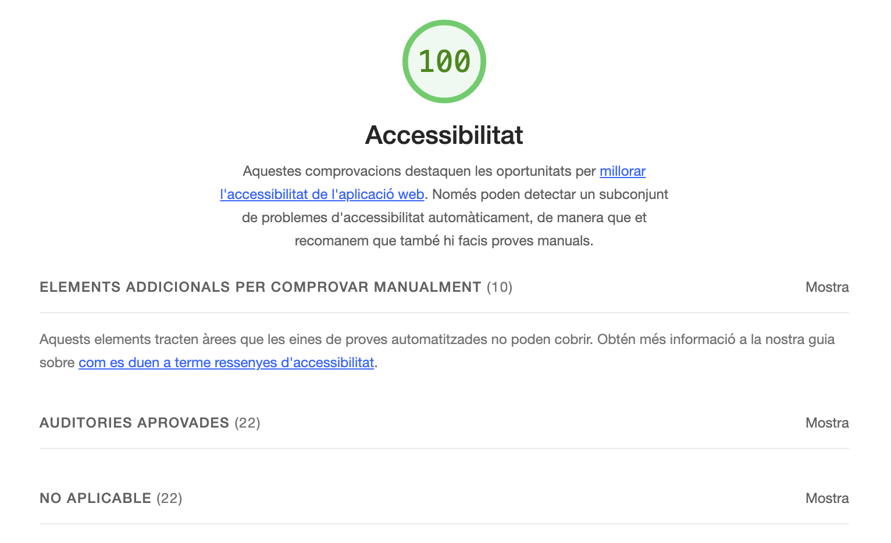

# Accessibility

- [Accessibility](#accessibility)
  - [Analysis](#analysis)
  - [Review list](#review-list)
    - [Semantic HTML](#semantic-html)
    - [Headings](#headings)
    - [Images](#images)
    - [Interactive](#interactive)
    - [Forms](#forms)
    - [Tables](#tables)
    - [Text](#text)
    - [Tabulation](#tabulation)
    - [ARIA](#aria)
    - [Reduced motion](#reduced-motion)
    - [Focus](#focus)
      - [How it works](#how-it-works)
      - [How `is-keyboard-active` is set on `body`](#how-is-keyboard-active-is-set-on-body)
      - [Focus ring customization](#focus-ring-customization)
      - [Which elements get the focus ring](#which-elements-get-the-focus-ring)
      - [How to make an element focusable](#how-to-make-an-element-focusable)
      - [Tabindex guidelines](#tabindex-guidelines)
    - [Colors](#colors)
    - [Skip Link](#skip-link)
    - [Angular Material / CDK](#angular-material--cdk)
  - [Testing tools](#testing-tools)
    - [Lighthouse](#lighthouse)
    - [Angular ESLint](#angular-eslint)
    - [Pa11y CI Accessibility Test Runner](#pa11y-ci-accessibility-test-runner)
    - [Playwright and axe (eco apps)](#playwright-and-axe-eco-apps)
    - [jest axe](#jest-axe)
  - [Useful links](#useful-links)

## Analysis

Every app targets **WCAG 2.2 AA** (since 2026-11-24).
The automated checks cover less: Pa11y's `WCAG2AA` standard means 2.1 AA at most, and axe-core has one 2.2 rule (`target-size`).
The `.pa11yci.json` of eco-store and eco-admin (META-39) check every page twice: with HTML_CodeSniffer, Pa11y's default runner, and again as `<url>#axe` with axe and `"rules": ["target-size"]`.
The two runners cannot share one entry: HTML_CodeSniffer throws on `target-size` («not a valid WCAG 2.1 rule»), and the `#axe` fragment keeps pa11y-ci from filing both results under one URL.
The axe entries ignore the rules that failed on develop on 2026-11-24, until their tasks are fixed.
In both apps that is `color-contrast`, which HTML_CodeSniffer still checks; in eco-store also `aria-dialog-name`, `aria-hidden-focus` and `aria-required-children`.
Axe runs on a fresh browser, where the PWA install sheet covers the page, and most of those failures are that sheet's.
Pa11y covers 2.5.8 Target Size only.
In eco-store and eco-admin the [Playwright suite](#playwright-and-axe-eco-apps) also checks 2.4.11, 3.3.7 and 3.3.8 on the screens it opens.
Anywhere else, review the other five AA criteria 2.2 adds by hand:

- 2.4.11 Focus Not Obscured (Minimum)
- 2.5.7 Dragging Movements
- 3.2.6 Consistent Help
- 3.3.7 Redundant Entry
- 3.3.8 Accessible Authentication (Minimum)

The first review (META-39, 2026-11-24) found three failures, all fixed since. Look for the same patterns:

- 2.4.11: the eco-store shell scrolls inside `mat-sidenav-content`, so the scroll padding that keeps focus clear of the fixed bars belongs there, not on `html`.
- 2.5.7: every drag needs a single-pointer alternative, as the image cropper's pan and zoom buttons.
- 1.3.5: a field that collects the user's own data takes its `autocomplete` token (`name`, `tel`, `email`), not `off`.

Its open points are in the META-39 section of the root `TASKS.md`.

A todo list of accessibility actions and related information can be found in the [Accessibility](https://github.com/plastikaweb/plastikspace/wiki/Accessibility) wiki page.

## Review list

### Semantic HTML

- Use semantic HTML.
- Use landmarks: `<header>`, `<footer>`, `<main>`, `<aside>`.
  While using material components, you can mark elements like `mat-toolbar` or `mat-sidenav-content` with the correct `role`:
   > `<mat-toolbar role="banner"></mat-toolbar>`
   >
   > `<mat-sidenav-content role="main"></mat-sidenav-content>`
- Use angular dynamic title strategy.

### Headings

- Use headings with the correct order. Just one `h1` per page.

### Images

- Use `alt` attributes for images.
- If the image is decorative, use an empty alt attribute. You can also hide it form the Accessibility Tree using `aria-hidden=true`.
- Add hidden description inside the tag that uses a bg image.
- Use `role="img"` and a title to describe `<svg>` images.

```html
<svg role="img" aria-labelledby="twitter-title">
    <title id="twitter-title">Follow on Twitter</title>
    <path ....>
</svg>
```

### Interactive

- Use buttons for interactive elements.
- Use links for navigation and external linking.
- Links must have context and be descriptive.

### Forms

- Use `label` with form controls.
- Add `role` to form: 'search' for a search form.
- Add `novalidate` to each form.
- Add input `type` attributes.
- Use `fieldset` and `legend` for describing complex forms parts.

### Tables

- Use `caption` to describe the table contents.
- Use `scope` attr (col | row).

### Text

- Use `em` or `rem` as text size units.

### Tabulation

- Don't use positive `tabindex`. Visual order should match DOM order.

### ARIA

- Use `aria-label`, `aria-labelledby` when needed to add meaning to links, svg images, tables and buttons.

### Reduced motion

- Apply `Tailwind Reduced Motion Variants` for elements with animations or transitions to disable them for users with reduced motion.

```css
<mat-loading-bar class="animate-radar motion-reduce:animate-none"></mat-loading-bar>
```

### Focus

- The focus ring is handled globally by the app a11y styles (instead of defining ad-hoc `:focus-visible` rules per feature).
- In your app, the global focus styles are included in `apps/<app>/src/styles/styles.scss` via:

```scss
@use 'core_a11y';
```

- The focus system lives in `libs/core/styles/util/material/src/_core_a11y.scss`.

#### How it works

- Focus is only visually emphasized when the user is navigating with the keyboard.
- When the page is in keyboard navigation mode, `body` has the class `is-keyboard-active`.
- The focused element is “marked” using `anchor-name: --focus-element` (CSS Anchor Positioning), and a fixed `body::after` draws a single focus ring around that anchor.
- The focus ring styling can be customized via CSS variables.

#### How `is-keyboard-active` is set on `body`

- In your app, `AppComponent` must use Angular CDK `FocusMonitor` to detect the focus origin and toggles the class on `document.body`.
- When the focus origin is `keyboard`, `body` gets `is-keyboard-active`. For any other origin (mouse/touch/program), the class is removed.

```ts
ngOnInit(): void {
  this.#focusMonitor.monitor(this.#document.body, true).subscribe(origin => {
    if (origin === 'keyboard') {
      this.#renderer.addClass(this.#document.body, 'is-keyboard-active');
      return;
    }
    this.#renderer.removeClass(this.#document.body, 'is-keyboard-active');
  });
}
```

> **Note**: The `FocusMonitor` is provided by Angular CDK and should be injected in your `AppComponent`.

#### Focus ring customization

- `--focus-ring-color` and `--focus-ring-width` are the design tokens used by the global focus ring.
- Defaults are defined in `libs/core/styles/util/material/src/_core_a11y.scss` under `:root`.
- You can override them at app level (e.g. in `apps/<app>/src/styles/styles.scss` or a theme file) to match the brand colors.

```css
:root {
  --focus-ring-color: rgb(191, 37, 186);
  --focus-ring-width: 2px;
}
```

#### Which elements get the focus ring

- Native interactive elements, e.g. `a:focus-visible`, `button:focus-visible`.
- Angular CDK keyboard focus class: `.cdk-keyboard-focused`.
- Angular Material buttons: `.mat-mdc-button:focus-visible` (and variants).
- Custom elements that opt-in with the class `.make-it-focusable:focus-visible`.

#### How to make an element focusable

- Prefer semantic elements first:

```html
<button type="button">Action</button>
<a href="/path">Go</a>
```

- If you must use a non-interactive element (e.g. `div`, `span`, `mat-card`), you must:
  - Make it focusable with `tabindex="0"`.
  - Give it an appropriate `role`.
  - Provide keyboard interaction (at least Enter/Space) in addition to click.
  - Optionally add `.make-it-focusable` to ensure it participates in the global focus styling.

```html
<div
  class="make-it-focusable"
  tabindex="0"
  role="button"
  (click)="onAction()"
  (keydown.enter)="onAction()"
  (keydown.space)="onAction()"
>
  Action
</div>
```

#### Tabindex guidelines

- To intentionally remove an element from the tab order, use `tabindex="-1"`.
- To make an element focusable, use `tabindex="0"`.
- Do not use positive `tabindex` values.

### Colors

- Make sure to use contrast ratios of at least 4.5:1 for regular text and background colors and 3:1 for large text.

### Skip Link

- Use `skip-link` to navigate to the main content.
- Use the available [`skip-link-util`](../libs/shared/util/skip-link/README.md) component.

```html
<plastik-skip-link></plastik-skip-link>
```

### Angular Material / CDK

- Please review Accessibility guides for each component at the end of the Overview tab: [Angular Material Components](https://material.angular.io/components/categories).
- Please review `A11y` guidelines from [CDK documentation](https://material.angular.io/cdk/a11y/overview).
- Use [`LiveAnnouncer`](https://material.angular.io/cdk/a11y/overview) to announce messages for screen-reader users using `aria-live` region. Specially to inform of the state of API requests.

## Testing tools

### Lighthouse

Using [lighthouse plugin](https://developer.chrome.com/docs/lighthouse), passes the automatic accessibility test with a value of 100.



Other tools:

- [WAVE](https://wave.webaim.org/extension/)
- [axe DevTools](https://www.deque.com/axe/)
- [Accessibility Insights](https://accessibilityinsights.io/)
- [Firefox Accessibility Inspector](https://firefox-source-docs.mozilla.org/devtools-user/accessibility_inspector/)
- [NoCoffee – Vision Simulator for Chrome](https://accessgarage.wordpress.com/2013/02/09/458/)

### Angular ESLint

Some lint patterns are used to review accessibility.

See [@angular-eslint/schematics](https://github.com/angular-eslint/angular-eslint#readme) for further information.

```js
// Root eslint.config.mjs, abridged: every *.html file gets the template presets, then the
// accessibility rules below (and more template rules; the file has the full list).
...scoped([...angular.configs.templateRecommended, ...angular.configs.templateAccessibility], ['**/*.html']),
{
  files: ['**/*.html'],
  rules: {
    '@angular-eslint/template/no-positive-tabindex': 'error',
    '@angular-eslint/template/alt-text': 'error',
    '@angular-eslint/template/click-events-have-key-events': 'error',
    '@angular-eslint/template/elements-content': 'error',
    '@angular-eslint/template/interactive-supports-focus': 'error',
    '@angular-eslint/template/label-has-associated-control': 'error',
    '@angular-eslint/template/mouse-events-have-key-events': 'error',
    '@angular-eslint/template/no-autofocus': 'error',
    '@angular-eslint/template/role-has-required-aria': 'error',
    '@angular-eslint/template/table-scope': 'error',
    '@angular-eslint/template/valid-aria': 'error',
    '@angular-eslint/template/no-distracting-elements': 'error',
  },
},
```

### Pa11y CI Accessibility Test Runner

We use [pa11cy-ci](https://github.com/pa11y/pa11y-ci) accessibility test runner.

It runs against the different app pages, so each app should have a configuration file named `.pa11yci.json`:

```json
{
  "defaults": {
    "timeout": 5000
  },
  "urls": [
    "http://localhost:4200/page1",
    "http://localhost:4200/page2",
  ]
}
```

In `package.json` you must add a script to run the test runner:

```json
"my-app:http-server": "angular-http-server --path dist/apps/my-app --port 8080 --silent",
"my-app:a11y": "nx run my-app:build",
"my-app:a11y": "npm-run-all --parallel --race my-app:http-server my-app:a11y:run",
"my-app:a11y:run": "pa11y-ci --config ./apps/my-app/.pa11yci.json",
```

This script (`my-app:a11y`) can be used with `husky hooks` and `github actions CI`. You can see an example in the [git-flow](./git-flow.md#pull-request-github-actions) section.

### Playwright and axe (eco apps)

Pa11y loads a URL and audits what is there.
For eco-store that is little: without products the product page never leaves its loading screen, the cart pages redirect with an empty cart, and nothing is signed in.
`apps/eco-a11y-e2e` (META-40) audits each screen in the state a user sees it instead:

- **Screens.** eco-store: the catalogue, the catalogue sorted 75 a page, a product page, the cart summary with a product, the delivery step after signing in,
  the sign-in and password recovery screens, the personal details form, and the catalogue with the PWA install sheet open.
  eco-admin: the sign-in screen and the first screen after signing in.
  Each one at 320 px light, 320 px dark and 1280 px.
- **Data.** The production builds talk to the hosted PocketBase; the suite answers every request to it from `src/support/records.ts`
  (a tenant open every day, one category, two products, a member and an administrator) and aborts anything else but Google Fonts.
  Sign-in accepts any password and returns an unsigned token, which the PocketBase SDK takes as a session.
  No PocketBase runs, local or remote.
- **Checks.** axe with every WCAG 2.2 AA rule (`wcag2a` to `wcag22aa`), after Material Symbols loads:
  until then an icon is the word of its ligature, and axe reads it as the button's text.
  Then, in the light projects, 2.4.11: 40 presses of Tab, failing when a focused element is wholly covered by fixed or sticky content it is not part of.
  The sign-in screens check 3.3.8 (`autocomplete` tokens, paste allowed), the personal details form 1.3.5,
  and the delivery step 3.3.7 (home delivery offers the saved address).
- **Known violations.** A failure found before its fix is listed in the spec as a `KnownViolation`: one rule, the nodes it hits, the criterion and the task.
  It passes and shows in the report as `known violation`; once fixed, the report says `known violation not found`, and the entry goes.
  A whole rule is never switched off.
- **Running it.** `yarn eco-a11y:e2e` builds both apps (`dependsOn: ["^build"]`), serves them on 4300 (as `el-llevat.localhost`, the tenant's host) and 4304,
  and runs in the system Chrome (`channel: 'chrome'`), with no browser download.
  It takes about two minutes on four cores; Playwright's default of two workers was faster there than four.
  The HTML report, with each test's axe results, is in `dist/.playwright/apps/eco-a11y-e2e/playwright-report`.

It runs next to Pa11y until it replaces it in the pre-push.

### jest axe

We should also add unit testing for any UI type component using the [jest-axe](https://github.com/nickcolley/jest-axe#readme) library.

```typescript
import { axe } from 'jest-axe';
// other imports...

describe('MyComponent', () => {
  let component: MyComponent;
  let fixture: ComponentFixture<MyComponent>;

  beforeEach(async () => {
    await TestBed.configureTestingModule({
      imports: [MyComponent],
    }).compileComponents();

    fixture = TestBed.createComponent(MyComponent);
    component = fixture.componentInstance;
  });

  it('should have no accessibility violations', async () => {
    expect.extend(toHaveNoViolations);
    const results = await axe(fixture.nativeElement);
    expect(results).toHaveNoViolations();
  });
});
```

## Useful links

- [https://www.w3.org/WAI/tips/](https://www.w3.org/WAI/tips/)
- [https://www.w3.org/WAI/tutorials/](https://www.w3.org/WAI/tutorials/)
- [lighthouse for chrome](https://chrome.google.com/webstore/detail/lighthouse/blipmdconlkpinefehnmjammfjpmpbjk/related?hl=es)
- [@angular-eslint/schematics](https://github.com/angular-eslint/angular-eslint#readme)
- [Build more accessible apps in Angular](https://www.youtube.com/watch?v=Gm_bD1abFXI)
- [Angular a11y: 11 tips on how to make your apps more accessible](https://indepth.dev/posts/1152/angular-a11y-11-tips-on-how-to-make-your-apps-more-accessible)
- [Accessibility in Angular](https://angular.io/guide/accessibility)
- [Angular ESLint Rules for Accessibility Series' Articles](https://dev.to/sandikbarr/series/20450)
- [Learnings from Accessibility Workshop from Enterprise NG 2020](https://dev.to/alfredoperez/learnings-from-accessibility-workshop-from-enterprise-ng-2020-2k57)
- [Angular, Accessibility, and You](https://dev.to/mattnmoore/angular-accessibility-and-you-12g9)
- [Pa11y CI](https://github.com/pa11y/pa11y-ci)
- [Test for accessibility and help millions of people by Tim Deschryver](https://timdeschryver.dev/blog/test-for-accessibility-and-help-millions-of-people#pa11y)
- [jest-axe](https://github.com/nickcolley/jest-axe#readme)
